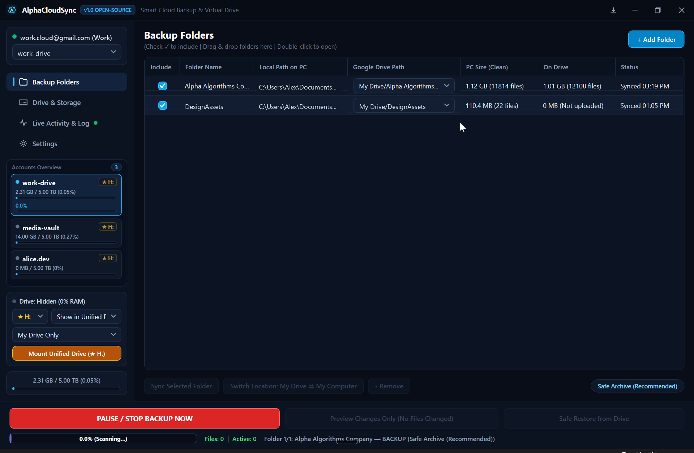
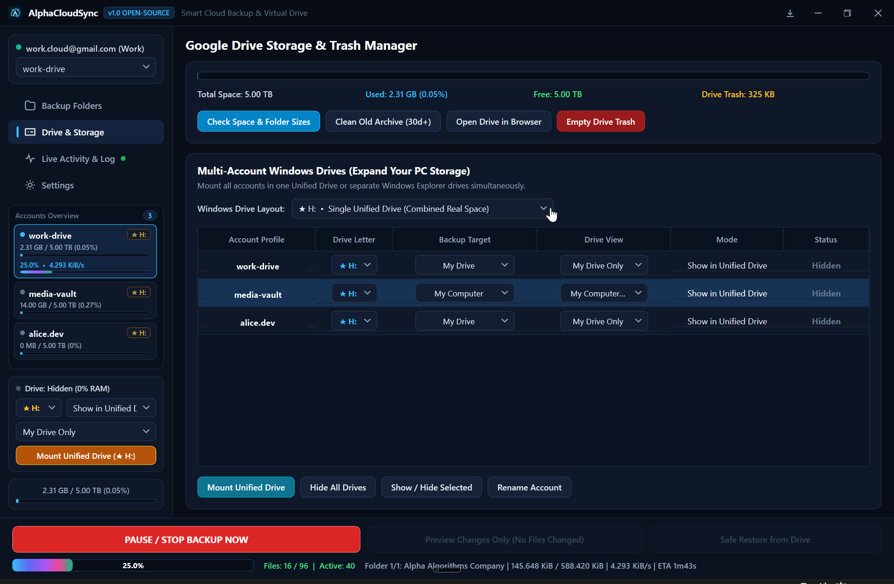
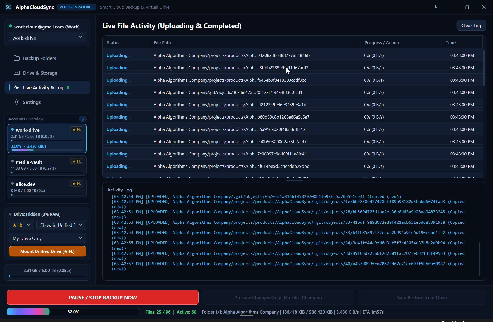
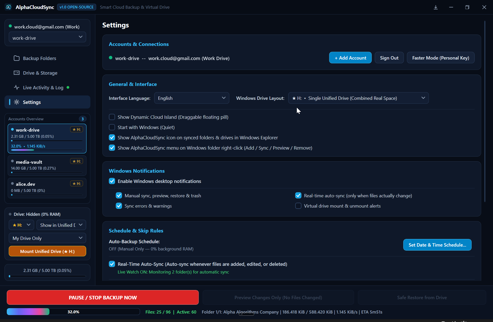
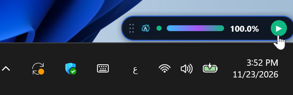
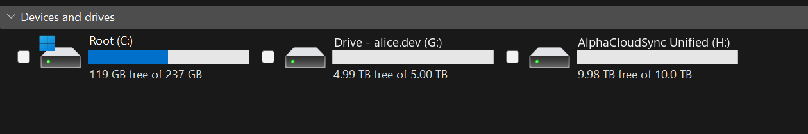
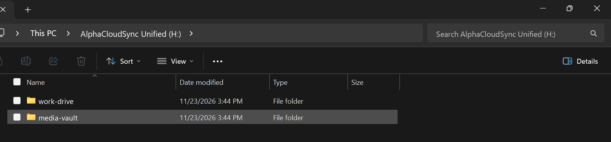

<p align="center">
  
</p>

<h3 align="center">轻量、高速、透明的 Windows 云存储控制核心 — 首发支持 Google Drive。</h3>

<p align="center">
  一款开源便携的 Windows 云盘工作台（v1.0 首发全面支持 <strong>Google Drive</strong>，采用模块化<strong>云提供商注册架构</strong> + <a href="https://rclone.org/">rclone</a> 与 <a href="https://winfsp.dev/">WinFsp</a>，便于后续扩展多云）——提供零臃肿文件夹备份、<strong>混合统一盘（<code>★ G:</code>）+ 独立多账号资源管理器虚拟盘</strong>、零内存占用文件夹徽标与右键菜单、实时自动同步、一键全局暂停省带宽、防覆盖安全恢复、按账号隔离排除规则、100% <strong>Obsidian Dark Fluent</strong> 暗黑界面以及可自由拖动的<strong>灵动云岛</strong>。<br/>
  由 <a href="https://github.com/AlphaAlgos">Alpha Algorithms Company</a> 开发。
</p>

<p align="center">
  <a href="LICENSE"></a>
  
  <a href="https://github.com/AlphaAlgos/AlphaCloudSync/releases/latest/download/AlphaCloudSync-Setup-x64.exe"></a>
  <a href="https://github.com/AlphaAlgos/AlphaCloudSync/releases/latest/download/AlphaCloudSync.exe"></a>
  
  
  
  <a href="https://github.com/sponsors/AlphaAlgos"></a>
</p>

<p align="center">
  <a href="README.md">English</a> · <a href="README.ar.md">العربية</a> · <a href="README.es.md">Español</a> · <a href="README.fr.md">Français</a> · <a href="README.de.md">Deutsch</a> · <strong>中文 (简体)</strong> · <a href="README.id.md">Bahasa Indonesia</a>
</p>

<p align="center">
  <a href="https://github.com/AlphaAlgos/AlphaCloudSync/releases/latest/download/AlphaCloudSync-Setup-x64.exe"><strong>⬇ 直接下载 Windows 安装包 (.exe)</strong></a> · <a href="https://github.com/AlphaAlgos/AlphaCloudSync/releases/latest/download/AlphaCloudSync.exe">便携版 (.exe)</a> · <a href="docs/USER_GUIDE.md">使用指南</a> · <a href="BENCHMARKS.md">性能基准</a> · <a href="CHANGELOG.md">更新日志</a> · <a href="SECURITY.md">安全说明</a> · <a href="CONTRIBUTING.md">参与贡献</a>
</p>

---

## 界面与虚拟盘截图预览

<p align="center">
  
  <br/>
  <em><strong>备份文件夹工作台</strong> — Obsidian Dark Fluent 暗黑界面、多账号侧边概览与彩虹光谱总进度条</em>
</p>

<table>
  <tr>
    <td width="50%" align="center"><br/><sub><strong>驱动器与存储管理</strong> — 混合统一盘 (<code>★ H:</code>) 与多账号独立虚拟盘</sub></td>
    <td width="50%" align="center"><br/><sub><strong>实时活动与日志</strong> — 优先级文件队列、上传脉冲绿点与实时控制台</sub></td>
  </tr>
  <tr>
    <td width="50%" align="center"><br/><sub><strong>设置</strong> — 7 种语言、资源管理器徽标与右键菜单、细分通知与实时自动同步</sub></td>
    <td width="50%" align="center"><br/><sub><strong>灵动云岛 (Dynamic Cloud Island)</strong> — 任务栏上方可自由拖动的半透明胶囊</sub></td>
  </tr>
  <tr>
    <td width="50%" align="center"><br/><sub><strong>Windows 资源管理器</strong> — 独立盘 (<code>G:</code>) 与统一盘 (<code>H:</code>) 并列显示</sub></td>
    <td width="50%" align="center"><br/><sub><strong>统一盘内部 (<code>H:</code>)</strong> — 每个已连接账号自动显示为独立文件夹</sub></td>
  </tr>
</table>

---

## 为什么选择 AlphaCloudSync 替代官方 Google Drive 桌面端？

| 日常痛点 | 官方 Google Drive 桌面端 | AlphaCloudSync v1.0 |
| :--- | :--- | :--- |
| **重装 Windows 后？** | 自动生成 **`My Computer (1)`** 并重新上传数十 GB | **零重复** — 直接衔接原有 `My Drive` 或固定 `My Computer` 名称 |
| **后台内存占用** | 常驻后台进程持续占内存 | **关闭后 `0.0 MB` 内存** · 挂载活跃 `G:` 虚拟盘实测仅 **`49.6 MB`** *(详见 [`BENCHMARKS.md`](BENCHMARKS.md))* |
| **误传缓存与构建垃圾** | 上传 `node_modules`、`.venv`、`.gradle`、`*.tmp` | **按账号排除规则（`presets/`）**自动跳过开发/媒体垃圾并显示节省空间 |
| **本地误删文件** | 静默同步可能清除云端文件 | **3 种清晰删除策略**（安全归档 / 仅复制 / 精确镜像）+ 过滤感知空源防误删 + `--max-delete 200` |
| **从云端恢复到电脑** | 存在直接覆盖本地新文件的风险 | **安全恢复** — 先预览不改文件 + 覆盖前自动备份本地原文件到 `restore-backups\` |
| **多 Google 账号管理** | 多账号配置受限 | **混合模式：统一盘（`★ G:`）+ 独立盘（`D:`–`Z:`）** — 合并显示为 `AlphaCloudSync` 或拆分独立盘符（`Drive - <账号>`） |
| **文件夹图标与右键菜单** | 注入沉重的资源管理器 DLL | **零内存文件夹徽标、虚拟盘图标与右键菜单**（添加/同步/预览/移除） |
| **自动化与带宽控制** | 强制后台常驻同步 | **自由选择：** **极速实时自动同步**（`--files-from`）+ **托盘一键全局暂停** **或** **Windows COM 定时计划**（关闭 `0.0 MB` 内存） |
| **体积与透明度** | 臃肿安装包与后台静默更新 | **单文件便携 EXE `~1.16 MB`** · 强制 SHA-256 校验 · 零 CMD 弹窗 · 零遥测 |

---

## 核心功能亮点（`src/AlphaCloudSync.ps1` 与 `src/modules/`）

### 1. 混合统一盘（`★ G:`）+ 多账号独立虚拟盘（`D:` – `Z:`）
- **单一统一盘（`★ G:`）：** 通过 `rclone mount :combine:` 将选定账号合并为资源管理器中的 **`AlphaCloudSync`** 驱动器，每个账号自动以独立目录呈现并防重名。
- **独立盘符与混合模式：** 自动分配无冲突盘符并保持单行卷标（**`Drive - <账号>`**，不超过 21 字符），支持将单个账号独立分盘而其余保留在 `★ G:` 中。
- **按账号挂载视图与缓存：** 可选 **`仅我的云端硬盘`**、**`仅我的电脑`** 或 **`两者同时`**；支持 **仅在线（不占永久 SSD 空间）** 与 **离线副本（本地缓存）**；关闭主程序后驱动器依然持久可用（`0.00%` 空闲 CPU），内置静默刷新与 **PID 身份防误杀保护（`T21`）**。

### 2. 零内存同步徽标、盘符图标与 Windows 右键菜单
- 基于原生 `desktop.ini` + `SHChangeNotify`，自动写入 `.git/info/exclude`（绝不修改 `.gitignore`），绝不覆盖用户原有 `desktop.ini`，且同步时自动排除 `desktop.ini`。
- **资源管理器文件夹右键菜单（`HKCU`）：** 右键任意文件夹 → **AlphaCloudSync** → **添加到云同步（支持选择账号与目标位置） / 立即同步 / 仅预览 / 移除** — 7 语言自适应、支持磁盘根目录（`"%V\."`）及原子 IPC 队列。

### 3. 100% Obsidian Dark Fluent 暗黑界面、极速启动与零 CMD 闪屏
- **~30ms 五阶段暗黑启动卡片 + 前置显示 + 逐账号异步加载：** 点击即现圆角暗黑启动卡片，按当前语言实时逐行显示 5 个启动阶段，主窗口强制置顶呈现在所有打开程序之前（`AllowSetForegroundWindow` + `AttachThreadInput`），并在窗口打开后**逐个异步刷新多账号状态**（当前账号优先），即使登录 10–50 个账号也能秒开不卡顿。
- **绿色呼吸上传指示灯：** 仅在实际上传时于「实时活动」旁柔和呼吸闪烁，空闲时自动隐藏。
- **零 CMD 黑窗（`T15`）** + 定制暗黑风格浏览器 OAuth 确认页（`rclone authorize --template`）。

### 4. 极速实时自动同步、全局暂停、精细通知与 COM 定时计划
- **定向实时自动同步（默认关闭）：** 本地过滤后以 `--files-from` 在约 2 秒内完成改动文件上传（`4s` 防抖，自动忽略 `.git`/`node_modules`/`*.tmp` 等）。
- **托盘一键全局暂停 / 恢复** + **4 类独立 Windows 通知开关**（0 文件变动绝不打扰）+ **独立于系统区域日期格式的 COM 计划任务（12 小时制 AM/PM）**。

### 5. 优先级活动队列、排除规则、安全恢复与 7 种语言（`345` 词条）
- **智能排序队列：** 正在上传置顶 → 已完成/已归档显示 3.5 秒后自动清理 → 排队/删除同步/重命名按顺序在下方排队。
- **过滤感知空源防误删（`rclone lsf`）**、Fail-Closed 规则校验、`--max-delete 200`、**安全恢复**、可自由拖动的**灵动云岛（`~250 × 32 px`）**，以及 7 种完整语言（**345 词条**）。

---

## 实测性能基准（[`benchmarks/latest-results.json`](benchmarks/latest-results.json)）

在 **Intel Core i5-7Y57 (1.20 GHz) / 7.9 GB RAM / Windows 11 Pro** 上通过 [`benchmarks/run-benchmarks.ps1`](benchmarks/run-benchmarks.ps1) 实测：

| 测试场景 | 实测结果 | 峰值内存 | 空闲 CPU |
| :--- | :---: | :---: | :---: |
| **便携可执行文件（`AlphaCloudSync.exe`）** | **`~1.16 MB`**（`1,191.5 KB`，内置 27 项资源） | — | — |
| **关闭 / 计划任务空闲模式** | 0 后台进程 | **`0.0 MB`** | **`0.00%`** |
| **持久虚拟盘（`G:` 仅在线空闲）** | 主程序关闭后仍可浏览 | **`49.6 MB`** | **`0.00%`** |
| **未过滤扫描（`2,800` 文件 / `39.06 MB`）** | **`7.440 秒`** | **`50.2 MB`** | 低 |
| **启用排除过滤扫描（跳过 `node_modules`/`.venv`）** | **`3.509 秒`**（跳过 **`2,400` 垃圾文件 / `37.5 MB` = 96.0% 体积 — 提速 2.1 倍**） | **`49.5 MB`** | 低 |
| **安全归档同步（`400` 有效文件）** | **`4.113 秒`** | **`54.4 MB`** | 低 |
| **防覆盖安全恢复（`--backup-dir`）** | **`0.838 秒`** | **`49.2 MB`** | 低 |
| **无界面 CLI（`AlphaCloudSync.exe -Action Status`）** | **`ExitCode: 0`**（`9.853 秒`） | 低 | — |

---

## 30 秒快速开始（Windows 10 / 11 x64）

```powershell
# 方式 1：一行 PowerShell 安装（强制 Fail-Closed SHA-256 校验）
irm https://raw.githubusercontent.com/AlphaAlgos/AlphaCloudSync/main/install.ps1 | iex

# 方式 2：从 GitHub Releases 下载 AlphaCloudSync.exe 与 SHA256SUMS.txt
# 方式 3：2 秒从源码本地构建
git clone https://github.com/AlphaAlgos/AlphaCloudSync.git
cd AlphaCloudSync
.\build\build-release.ps1

# 运行全部 25 项自动化测试（T01-T25）
powershell -NoProfile -ExecutionPolicy Bypass -File .\tests\run-tests.ps1
```

## 隐私、安全与许可证
- **零遥测：** 无统计追踪、无第三方服务器；OAuth 令牌仅保存在本地 `%APPDATA%\rclone\rclone.conf`。
- **SmartScreen 提示：** 开源社区版目前尚未购买商业 EV 代码签名证书，请先校验 `SHA256SUMS.txt` 或自行从源码构建。详见 [`SECURITY.md`](SECURITY.md)。
- **开源协议：** [MIT License](LICENSE) — 由 **Alpha Algorithms Company** 独立开发，与 Google LLC 无隶属关系。
