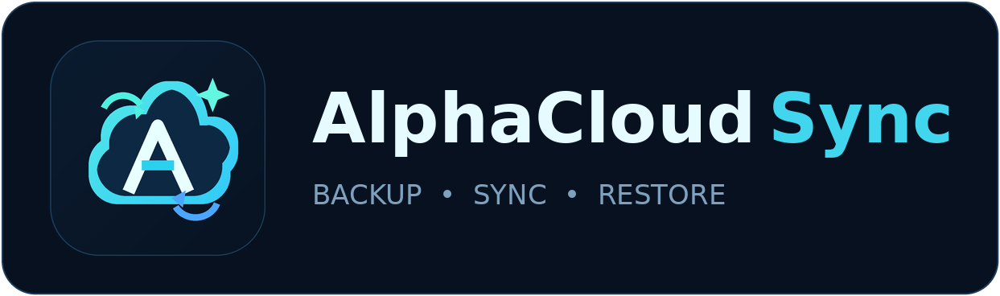

# AlphaCloudSync v1.0.0 — Official Release

<p align="center">
  
</p>

> **A Lightweight, Fast & Transparent Cloud Storage Control Core for Windows — Starting with Google Drive.**  
> A self-contained portable Windows studio (`~1.12 MB` executable over `rclone` + `WinFsp`) delivering zero-bloat folder backups, a **Hybrid Unified (`★ G:`) + Standalone Multi-Account Explorer Drive Hub**, Zero-RAM Synced Folder Badges, optional **Real-Time Auto-Sync**, overwrite-protected **Safe Restore**, per-account **Skip Rules**, a **100% Obsidian Dark Fluent UI** with zero CMD flashes, and a freely draggable **Dynamic Cloud Island**.

---

## Quick Install (Windows 10 / 11 x64)

### 1-Line Fail-Closed PowerShell Install (Recommended)
```powershell
irm https://raw.githubusercontent.com/AlphaAlgos/AlphaCloudSync/main/install.ps1 | iex
```
Downloads `AlphaCloudSync.exe` and `SHA256SUMS.txt` into `%LOCALAPPDATA%\AlphaCloudSync\app\`, **enforces Fail-Closed SHA-256 verification** (immediately aborts & deletes the downloaded file if `SHA256SUMS.txt` is missing, malformed, or mismatched), creates Desktop & Start Menu shortcuts, and adds `AlphaCloudSync` to your user `PATH`.

### Manual Portable Download
1. Download **`AlphaCloudSync.exe`** and **`SHA256SUMS.txt`** from the release assets below.
2. Verify integrity in PowerShell against `SHA256SUMS.txt`:
   ```powershell
   Get-FileHash .\AlphaCloudSync.exe -Algorithm SHA256
   ```
3. Double-click `AlphaCloudSync.exe` — if `rclone` is not installed yet, click **Yes** on the first-launch prompt to install it automatically with official `SHA256SUMS` verification.

---

## What's New in v1.0.0

### 1. Hybrid Unified (`★ G:`) + Standalone Multi-Account Windows Drives (`D:` – `Z:`)
- **Single Unified Drive (`★ G:`):** Combine chosen Google accounts into one Windows Explorer drive labeled **`Google Drive Unified`** (`rclone mount :combine:`), with each account appearing as an auto-deduplicated folder inside (`alice.dev`, `alice.dev (2)`).
- **Standalone Drives (`D:` – `Z:`):** Mount any account individually (double-click any row) or click **Mount All Accounts** for automatic collision-free drive letters (`G:`, `H:`, `I:`...) with concise 1-line Explorer labels (**`Drive - <Account>`**, `<= 21` chars so Explorer always keeps `"X TB free of Y TB"` visible).
- **Hybrid Per-Account Control:** Split any account onto its own dedicated letter (`H:`, `I:`, etc.) while keeping the remaining pool inside `★ G:`.
- **Per-Account Drive View (`MountScope`):** Choose `My Drive Only`, `My Computer Only`, or `My Drive + Computer` (`Both`).
- **Online Only (`0 GB` SSD) vs Offline Copy:** Online Only (`--vfs-cache-mode writes`) keeps no permanent offline mirrors on your SSD (only a minimal temporary write buffer flushed automatically). Drives stay mounted in Explorer even after closing AlphaCloudSync (`31.3 MB` RAM / `0.00%` idle CPU).
- **Sidebar Accounts Overview:** Live scrollable cards for every account showing status dot, drive badge (`★ G:` / `H:`), quota bar, and live sync progress.

### 2. Zero-RAM Synced Folder Badges & Drive Icons (`.git/info/exclude` Safe)
- Marks synced local folders with `AlphaCloudSync-folder.ico` via native Windows `desktop.ini` + `SHChangeNotify` (`0.0 MB` extra RAM, zero Explorer DLL injection) and sets `HKCU\...\Explorer\DriveIcons` on mounted drives.
- **`.git/info/exclude` Safety:** Automatically appends `desktop.ini` to parent `.git/info/exclude` without touching tracked `.gitignore`.
- **Non-Destructive & Cloud Safe:** Refuses to overwrite existing user-created `desktop.ini` files and excludes `desktop.ini` from Drive uploads (`--exclude "desktop.ini"`).

### 3. 100% Unified Obsidian Dark Fluent UI + Silent OAuth + Zero CMD Windows
- Every `ComboBox`, `CheckBox`, `TextBox`, `DatePicker`, `ContextMenu`, `ToolTip`, `ScrollBar`, `DataGrid`, `Show-AlphaMessageBox`, modal dialog, and System Tray menu (`AlphaDarkTrayRenderer`) is custom-templated Obsidian Dark (`#080D17` / `#0F1829`).
- **Zero CMD Flashes:** `0` `cmd /c` and `0` `-WindowStyle Normal` calls (`T15` verified).
- **Silent OAuth:** Leave the optional display name box blank to auto-generate unique remote IDs (`gdrive`, `gdrive-2`, ...) and auto-extract your Google email username; sign-in runs silently in your browser (`127.0.0.1`) behind dark **"Waiting for Google Sign-In"** and **"Connected Successfully"** modals.
- **Windows 11 Taskbar Identity & 38px `WindowChrome`:** Native `AppUserModelID` + `WM_SETICON` + `SHGetPropertyStoreForWindow`, Aero Snap, symmetric Maximize, and single-instance restore.

### 4. Real-Time Auto-Sync (ON/OFF) + 12h Windows Task Scheduler
- **Real-Time Auto-Sync (`OFF` by default):** Native .NET `AlphaFolderWatchHub` (`FileSystemWatcher`) monitors the active account's enabled folders while AlphaCloudSync is running (including in System Tray), ignores `.git`, `node_modules`, `.venv`, `__pycache__`, `.vs`, `.next`, `.expo`, `desktop.ini`, `Thumbs.db`, `~$*`, `*.tmp`, `*.part`, `*.crdownload`, waits **4 seconds** after edits settle, syncs automatically, and displays a System Tray completion popup.
- **12-Hour `AM / PM` Auto-Backup Scheduler:** Schedule One-Time, Daily, Weekly, or Every Few Hours (`1h`–`12h`) backups via Windows Task Scheduler (`0.0 MB` RAM when closed), with `backup-health.json` logging.

### 5. Per-Account Isolated Activity, Skip Rules, Safe Restore & Cloud Island
- Isolated per-account folder lists, **Live File Activity** feed, **Activity Log**, counters, and **Skip Rules** (`Developer`, `Creative & Media`, `General Backup`, visual JSON editor, `.json` importer).
- **3 Delete Policies + Safety Guards:** `Safe Archive` (`_CloudSync_Trash_Archive/<timestamp>/`), `Copy Only`, `Exact Match`, filter-aware Empty-Source Guard (enumerates included files using rclone's active filters), fail-closed invalid rules, and `--max-delete 200`.
- **Overwrite-Protected Safe Restore:** Dark review screen with **Preview Only (No Files Changed)** first, plus automatic local backups into `%LOCALAPPDATA%\AlphaCloudSync\restore-backups\` before replacing differing local files.
- **Freely Draggable Dynamic Cloud Island + Quick-Snap:** Translucent non-focus-stealing pill (`~250 × 32 px`) with 6-dot grip, auto-saved multi-monitor coordinates, 220ms hover-to-expand, right-click dark Quick-Snap menu, and Windows Taskbar progress glow.
- **7 Built-In Languages (`336` Identical Keys, Zero Jargon):** English · العربية (Full RTL & BiDi) · Español · Français · Deutsch · 中文 (简体) · Bahasa Indonesia.
- **Modular Architecture + Provider Registry (`src/modules/`):** Clean 13-module layout (`Core`, `Providers/Provider.GoogleDrive`, `Engine.Mount`, `Engine.Headless`, `UI`), System Tray Global Pause/Resume, Granular Windows Notification Controls, and Zero-RAM Windows Explorer Folder Right-Click Menu (`HKCU`).
- **3 Speed Modes + Faster Mode:** `Turbo`, `Balanced`, `Eco` (2 MB/s cap), plus optional personal Google Cloud Desktop Client ID for up to 5x faster uploads.

---

## Reproducible Benchmarks & Automated Verification

- **Automated Test Suite (`tests/run-tests.ps1`):** **`23 / 23 PASS`** (`T01`–`T23` with explicit `PASS`/`SKIP`/`FAIL` reporting & Windows CI covering 336-key 7-language parity, Fail-Closed SHA-256, non-destructive build guard, real `rclone` Safe Archive/Copy-Only/Mirror/Restore/Exclusions, filter-aware empty-source data-loss prevention `T16`, fail-closed rules/prefs/mutex/settings `T17`–`T20`, mount PID identity guard `T21`, fast `--files-from` auto-upload filter `T22`, modular architecture + Provider Registry + Global Pause + Explorer Context Menu `T23`, simultaneous dual-mount `T13`, 1-line labels & `:combine:` Unified mount `T14`, and Folder Badges + `.git/info/exclude` + Zero CMD `T15`).
- **Measured Performance (`benchmarks/run-benchmarks.ps1` on Intel Core i5-7Y57 / 7.9 GB RAM / Windows 11 Pro):**
  - Closed / Scheduled Idle: **`0.0 MB` RAM / `0.00%` CPU**
  - Persistent Explorer Drive (`G:` Online Only Idle): **`31.3 MB` RAM / `0.00%` CPU**
  - Filtered Repo Scan (`node_modules`/`.venv` skipped): **`0.680 sec`** vs **`5.181 sec`** raw (**7.6x faster**, **96.0% of repo size** skipped)
  - Filtered Safe-Archive Sync (`400` clean files): **`4.834 sec`** (`56.3 MB` peak RAM)
  - Overwrite-Protected Safe Restore: **`0.790 sec`** (`52.8 MB` peak RAM)

---

## Transparency, Privacy & SmartScreen Note

- **Zero Telemetry:** No analytics, no tracking, no third-party servers. OAuth runs directly between your browser, `rclone`, and Google (`127.0.0.1` loopback; refresh token stored locally in `%APPDATA%\rclone\rclone.conf`).
- **Windows SmartScreen:** Open-source community releases are currently **unsigned** (no commercial EV certificate yet), so SmartScreen may prompt on first launch. Verify `SHA256SUMS.txt` or build locally via `.\build\build-release.ps1` (27 auto-embedded runtime & modular resources).

---

## Documentation Links
- **README (English):** [`README.md`](https://github.com/AlphaAlgos/AlphaCloudSync/blob/main/README.md)
- **اقرأني (العربية):** [`README.ar.md`](https://github.com/AlphaAlgos/AlphaCloudSync/blob/main/README.ar.md)
- **User Guide (English):** [`docs/USER_GUIDE.md`](https://github.com/AlphaAlgos/AlphaCloudSync/blob/main/docs/USER_GUIDE.md)
- **دليل الاستخدام الشامل (عربي):** [`docs/USER_GUIDE.ar.md`](https://github.com/AlphaAlgos/AlphaCloudSync/blob/main/docs/USER_GUIDE.ar.md)
- **Benchmarks:** [`BENCHMARKS.md`](https://github.com/AlphaAlgos/AlphaCloudSync/blob/main/BENCHMARKS.md)
- **Security Policy:** [`SECURITY.md`](https://github.com/AlphaAlgos/AlphaCloudSync/blob/main/SECURITY.md)
